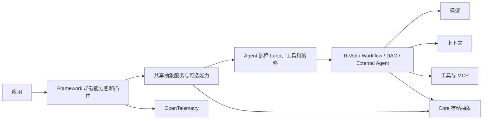

# EliteForge Agent Framework

EliteForge Agent Framework 是一个可扩展的 Rust Agent 框架。Framework 负责装配、执行和生命周期管理。能力包提供模型、工具、存储和可观测能力；上层应用提供 Harness，并负责认证、权限和业务流程。

自动路由提供对话自动路由、向量自动路由、多模态向量自动路由、重排自动路由四类接口。宿主提供候选并安装路由实现；Framework 原样传递候选，不解释供应商标签或执行供应商筛选规则。供应商规则由对应能力包处理，宿主也可以自行实现路由。Framework 校验选中模型属于候选范围，并在调用时校验模型能力。

切片由 `ChunkStrategy` 抽象与 `ChunkStrategies` 注册表装配。宿主提供标准块、表格行和原文位置；`eliteforge-agent-capability-chunking` 提供自动、结构、标题和固定长度策略，也支持宿主注册自己的策略。`RetrievalEvaluationRunner` 使用稳定的原文范围评测召回效果；评测题、授权、优化预算和索引发布由宿主负责。

能力包可携带 Skills、MCP、新插件、已有插件的扩展、工具等：

```rust
use eliteforge_agent_framework::{Framework, AgentSelection};
use eliteforge_agent_official_capability_pack::EliteForgeOfficialCapabilityPack;

// 由宿主预先创建权限受控的 agent-artifacts 目录。
let framework = Framework::builder()
    .capability_pack(EliteForgeOfficialCapabilityPack::new("agent.sqlite", "agent-artifacts"))
    .build().await?;
let agent = framework.agent(AgentSelection::default()).build().await?;
```

插件全部属于 Framework。存储在同一 Framework 内唯一、自动共享；工具和 Skills 默认不授权，由 Agent 显式选择。关闭 Agent 只停止自己的执行，关闭 Framework 才释放插件。完整规则和多 Agent 示例见[Framework 共享装配](docs/Framework共享装配.md)。

运行后可以额外安装能力包。安装包声明 `backend` 且包含扩展实现、插件或页面时，会启动独立进程，通过 RPC 与 Framework 交互。

运行时安装、签名、版本和加载机制见[动态能力包](docs/动态能力包运行时设计.md)；能力声明、配置工厂、共享实例和依赖规则见[能力包与自动装配](docs/能力包与统一装配.md)。



## 快速上手

### 1. 准备环境

需要 Rust/Cargo、Rust 工具链和 C 编译工具。先执行环境检查，再拉取锁定依赖：

```sh
make doctor
make install
```

### 2. 连接真实模型

Framework 默认启用 Genai。真实模型验证放在与 `crates/` 平级的 [integration-tests](integration-tests/README.md) 项目中，配置模型名和凭据后显式运行：

```sh
export MODEL="your-model"
export OPENAI_API_KEY="your-api-key"
cargo run -p eliteforge-agent-integration-tests --features live-model --bin default_model
```

代理服务可额外设置 `MODEL_ENDPOINT` 和 `MODEL_API_KEY`。完整代码和其他模型协议见[快速上手](docs/快速上手.md)。

## 支持的特性

| 分类 | 能力 | 支持情况 | 说明 |
| --- | --- | --- | --- |
| 运行 | 与 AI 连续对话并使用工具 | ✅ 已支持 | AI 可以边思考边回复，并在需要时调用工具完成用户交代的工作。 |
| 运行 | 按步骤执行工作流 | ✅ 已支持 | 可把复杂工作拆成多个步骤，按顺序或按条件执行，也支持并行处理和中断后继续。 |
| 模型 | 连接不同 AI 服务 | ✅ 已支持 | 可接入多家模型服务，并根据应用需要选择合适的模型。 |
| 内容 | 理解多种内容并按格式回答 | ✅ 已支持 | 支持文字、图片等输入，也可以按约定格式返回结果。 |
| 工具 | 调用工具完成工作 | ✅ 已支持 | 可校验工具参数、处理执行结果，并在合适时同时调用多个工具。 |
| 工具 | 在指定目录中查找和修改文件 | ✅ 已支持 | 可按应用授权范围读取、搜索和修改文件，避免访问范围之外的内容。 |
| 工具 | 在本机执行命令 | ✅ 已支持 | 可按应用配置执行本地命令，并查询仍在运行的命令及其结果。 |
| 上下文 | 在长对话中保留重点 | ✅ 已支持 | 会根据模型可处理的长度整理对话，必要时提炼历史内容，帮助 AI 延续当前工作。 |
| 记忆 | 保存并找回长期信息 | ✅ 已支持 | 应用可启用长期记忆并明确保存、检索条目；框架不会自动从对话提取记忆。 |
| 连续性 | 保存进度并在中断后继续 | ✅ 已支持 | 可记录对话和执行进度，在程序重启或任务中断后恢复工作。 |
| 人机协作 | 向用户提问并等待确认 | ✅ 已支持 | AI 可以暂停任务等待用户回答或批准，收到答复后继续执行。 |
| 运行控制 | 随时补充要求或停止任务 | ✅ 已支持 | 用户可以在执行过程中追加说明或取消任务；拆分出的子任务会遵守相应限制。 |
| 集成 | 连接外部工具和资源服务 | ✅ 已支持 | 可连接兼容的外部服务，发现并使用其提供的工具和资源。 |
| 集成 | 向聊天界面实时报告进展 | ✅ 已支持 | 可把回复、工具使用、任务状态和等待用户操作等进展发送给兼容的聊天界面。 |
| 扩展 | 按需组合和管理能力 | ✅ 已支持 | 可安装能力包来增加功能，并在应用启动时检查配置、处理依赖和恢复失败状态。 |
| 扩展 | 定制执行过程 | ✅ 已支持 | 应用可以在任务、模型调用和工具执行等环节加入自己的规则或处理逻辑。 |
| 扩展 | 提供可复用的技能指引 | ✅ 已支持 | 技能包可以为 AI 提供可复用的操作说明，并按需读取相关资料。 |
| 扩展 | 导入和管理能力包 | ✅ 已支持 | 支持从本地文件或网络地址导入能力包、管理版本和依赖，并在需要时回退；暂不提供在线商店。 |
| 多 Agent | 把工作交给其他 AI 助手 | ✅ 已支持 | 主助手可以分派子任务，并为其设置可用时间和工作额度。 |
| 多 Agent | 创建独立协作会话 | ✅ 已支持 | 可以创建独立会话、发送消息、等待回复并查看进度；跨进程长期保存由应用提供。 |
| 可观测 | 查看运行过程和问题 | ✅ 已支持 | 可记录任务、模型和工具的运行情况，供应用接入监控和问题排查服务。 |
| 工具 | 搜索和读取网页 | ✅ 已支持 | 接入搜索服务后，AI 可以查找网页内容并附上信息来源。 |
| 工具 | 读取图片和 PDF 文件 | ✅ 已支持 | 接入后可以读取本地图片和 PDF，并在需要时发现可用工具。 |
| 工具 | 编辑器操作 | 🧩 可扩展 | 应用可以接入编辑器能力，让 AI 协助查看和修改代码。 |
| 工具 | 操作浏览器 | 🧩 可扩展 | 应用可以接入浏览器操作能力，完成网页上的交互任务。 |
| 安全 | 管理工具使用权限 | 🧩 可扩展 | 应用可以决定哪些工具可用、何时需要用户确认，以及不同用户能执行哪些操作。 |
| 规划 | 先制定计划再执行 | 🧩 可扩展 | 应用可以提供只读规划模式，让 AI 先整理步骤，再由用户决定是否执行。 |
| 任务 | 记录待办和长期任务进度 | 🧩 可扩展 | 可组合工作流、状态保存和恢复能力；待办清单等面向用户的功能由应用定义。 |
| 多 Agent | 多个 AI 助手协同工作 | 🧩 可扩展 | 可组合多个助手和工作步骤实现协作；具体的分工和决策方式由应用设计。 |
| 安全 | 隔离高风险操作 | 🏠 上层应用负责 | 应用可以为命令和工具配置隔离环境，降低操作对其他文件和服务的影响。 |
| 多 Agent | 后台任务、队列与独立工作目录 | 🏠 上层应用负责 | 应用可以管理后台任务和排队执行，并为不同任务准备独立的工作目录。 |
| 产品接口 | 终端、命令行与 HTTP 服务 | 🏠 上层应用负责 | 框架负责提供 AI 执行能力；终端界面、命令行和 HTTP 服务由应用提供。 |
| 产品接口 | 查看文件改动并撤销 | 🏠 上层应用负责 | 应用可以接入版本管理功能，让用户查看文件变化并恢复到之前的状态。 |
| 配置 | 管理项目和个人设置 | 🏠 上层应用负责 | 应用负责读取、合并和保护项目设置及个人设置，并将生效配置交给框架。 |

与 Codex CLI、Claude Code、Hermes、Gemini CLI、Qwen Code 的工具清单对照、语义差距和补齐顺序，
见[主流 Agent 工具对照与补齐清单](docs/主流Agent工具调研.md)和[实现状态与验收证据](docs/实现状态与验收证据.md)。
命令清单、交互式输入和 PTY 见[本地命令工具](docs/本地命令工具.md)，资源接入见[MCP 资源](docs/MCP资源接入.md)。
补丁和搜索见[文件工具](docs/本地文件工具.md)，发现、Web 和媒体见[可选工具插件](docs/可选工具插件.md)。

## Crates 组织

```text
crates/
├── framework/     公共契约、Agent 执行、插件内核、能力声明和外部包运行时
├── plugin/        具体实现与配套实现库
│   ├── tool/      本地文件与命令、问答、Agent 协作、MCP、工具发现、Web、媒体
│   ├── model/     模型连接
│   ├── agent/     外部 Agent 适配
│   ├── observe/   遥测
│   ├── protocol/  AG-UI
│   ├── skill/     Skills
│   ├── context/   上下文能力与附件读取
│   ├── memory/    记忆能力
│   └── storage/   SQLite 与文件系统组成的本地存储
├── capability/    随仓库提供的 Rust 能力包装配入口
├── testing/       测试支持与跨 crate 样例
└── tools/         能力包开发宿主
```

完整 Crate 清单、官方能力配置示例和进程边界见 [crates/README.md](crates/README.md)。
`capability/` 是源码组织目录；外部安装包存放在包管理器根目录下的 `packs/<id>/versions/<version>`。

| Crate | 作用 |
| --- | --- |
| `eliteforge-agent-framework` | Agent 装配、循环调度、模型和工具执行 |
| `eliteforge-agent-core` | 公共类型、能力接口、CapabilityPack API 和 Plugin 契约 |
| `eliteforge-agent-capability-tools` | 按领域选择本地、Web、媒体、MCP、人机交互和 Agent 协作工具 |
| `eliteforge-agent-capability-external` | 装配独立的外部 Agent 执行循环与 CLI/JSON 服务桥 |
| `eliteforge-agent-capability-auto-routing` | 提供供应商无关的按候选顺序、稳定分配和对话故障切换路由实现 |
| `eliteforge-agent-capability-personai` | 接入 PersonAI 模型、搜索／图片生成／AIGC 工具及宿主 SDK 服务 |
| `eliteforge-agent-official-plugin-tools-local` | 进程内文件、命令和 PTY 实现；命令超过 10 秒返回 ID，提供读取与停止工具 |
| `eliteforge-agent-official-plugin-agent-external` | Codex/OpenCode CLI 与 JSON 服务桥的执行、事件转换和原生会话引用 |
| `eliteforge-agent-official-plugin-skills` | Agent Skills 标准文件系统发现、渐进式加载和可替换 Provider |
| `eliteforge-agent-official-plugin-tools-agents` | 子 Agent 委派与独立 Thread 协作工具 |
| `eliteforge-agent-plugin-core` | 服务注册、依赖排序和资源关闭 |
| `eliteforge-agent-capability-macros` | 编译时生成能力与扩展点注册代码，嵌入 Skills 资源 |
| `eliteforge-agent-capability-runtime` | 安装包管理、独立后端进程、RPC、页面会话和后端 SDK |
| `eliteforge-agent-capability-dev-host` | 开发时主动运行的调试宿主、示例后端和 MCP 服务；应用使用 Framework 无需启动它 |
| `eliteforge-agent-official-capability-pack` | 官方插件组合，一次配置到 Framework |
| `eliteforge-agent-official-plugin-*` | Genai、本地存储、MCP、AG-UI、OTel 等官方实现 |

## Agent 对接技能

[Framework 使用手册技能](crates/capability/eliteforge-agent-capability-development/skills/eliteforge-agent-framework-integration/SKILL.md) 提供可运行的入门程序、订单能力包项目模板，以及模型、工具、插件、上下文、Skills、MCP、审批和持久恢复教程。技能已迁入 Framework 的 `eliteforge.agent-development` 能力包统一维护，并随 Tron 默认安装。单独分发时，使用该能力包下完整的 `skills/eliteforge-agent-framework-integration/` 目录，保留其中的 `references/`、`assets/` 和 `agents/`。

技能以 Git tag `1.0.0` 为 API 基线，接入代码和场景说明随技能分发，无需先取得本仓库的 `docs/`。已有项目按需合入代码；新项目可以从 `assets/order-agent/` 开始。

## 文档

**入门与总览**

- [快速上手](docs/快速上手.md)：按场景运行 Agent，并查看 Rust 示例。
- [框架架构总览](docs/框架架构总览.md)：系统边界、服务装配、执行链和资源生命周期。
- [插件开发指南](docs/插件开发指南.md)：配置依赖、实现扩展并选择适合的能力包。
- [插件扩展点参考](docs/插件扩展点参考.md)：按接口查看注册类型、调用时机和多实例规则。
- [执行契约](docs/执行契约.md)：执行器、插件和应用必须共同遵守的运行约束。
- [实现状态与验收证据](docs/实现状态与验收证据.md)：当前实现范围、验证依据和适用限制。
- [主流 Agent 工具调研](docs/主流Agent工具调研.md)：对照主流 CLI 工具并列出支持边界。

**插件与运行时设计**

- [能力包与统一装配](docs/能力包与统一装配.md)：能力声明、选择、工厂配置和生命周期。
- [插件中间件与生命周期](docs/插件中间件与生命周期.md)：执行拦截、生命周期通知和清理顺序。
- [模型插件设计](docs/模型插件设计.md)：模型连接、协议适配、选择和多模态能力。
- [PersonAI 能力包](docs/PersonAI能力包.md)：模型同步、SDK 业务服务和账号边界。
- [外部 Agent 接入](docs/外部Agent接入.md)：独立执行循环、外部会话和取消边界。
- [Skills 插件设计](docs/Skills插件设计.md)：技能来源、发现、渐进式加载和资源读取。
- [上下文与会话设计](docs/上下文与会话设计.md)：会话记录、上下文预算、摘要和附件。
- [记忆与上下文技术设计](docs/记忆与上下文技术设计.md)：权威数据、派生摘要、长期记忆和信任边界。
- [本地存储插件设计](docs/存储抽象层Plugin-sqlite实现.md)：SQLite、文件附件、配置项和原生扩展。
- [可观测性设计](docs/可观测性设计.md)：追踪关联、恢复身份和错误脱敏。

**执行能力与应用接入**

- [用户交互与审批](docs/用户交互与审批.md)：持久化问答、工具审批和恢复执行。
- [Agent 协作](docs/Agent协作.md)：子 Agent、独立 Thread 和协作边界。
- [AG-UI 事件协议](docs/AG-UI事件协议.md)：Framework 事件映射及 SSE 输出。
- [MCP 资源接入](docs/MCP资源接入.md)：资源列表、模板读取和连接生命周期。
- [本地命令工具](docs/本地命令工具.md)：命令清单、持续输入、PTY 和进程管理。
- [本地文件工具](docs/本地文件工具.md)：目录授权、补丁编辑和稳定分页搜索。
- [可选工具插件](docs/可选工具插件.md)：工具发现、Web 搜索抓取及图片/PDF 读取。
- [宿主运行时接入](docs/宿主运行时接入.md)：PTY、外部 Agent、上下文准备与调用预算。

**动态能力包**

- [动态能力包运行时设计](docs/动态能力包运行时设计.md)：安装、签名、进程隔离、RPC、页面和重配。
- [动态能力包迁移说明](docs/动态能力包迁移说明.md)：公共 API 与扩展契约的迁移变化。
- [动态能力包验收](docs/动态能力包验收.md)：端到端覆盖、验证范围和平台边界。

## 常用命令

```sh
make format  # 格式化
make lint    # 格式、Clippy、编译和 Rustdoc 检查
make test    # workspace 测试和文档测试
make build   # 构建 release 产物
```

### Person-AI 语音本地联调

Person-AI SDK 使用固定 Git 提交，包含 `transcribe_wav` 与全双工会话接口；构建无需配置本机 SDK 目录。

语音识别由 `SpeechRecognitionModel` 统一执行。Person-AI 适配调用 SDK 的 `AudioTranscriptionsClient::transcribe_wav`；实时会话复用 SDK 的独立收发端。HTTP 模型插件提供 OpenAI 文件转写和 Gemini 音频转写适配。每次识别独占连接，取消或超时释放本次连接；连接不能跨账号或会话复用。

## License

Licensed under the [GNU Affero General Public License, Version 3.0](LICENSE) (`AGPL-3.0-only`).

Rust workspace 通过 Git tag 发布，统一版本升级与引用方式见[发布说明](docs/Git-tag发布.md)。

## 内置的第三方开源组件

下表列出仓库中直接包含或嵌入的主要第三方资源。它们保留各自的许可证；项目的 AGPL-3.0-only 许可不改变这些条款。Cargo 和 npm 的传递依赖不包含在此表中，具体版本见 `Cargo.lock` 和 `sdk/page/pnpm-lock.yaml`。

| 组件 | 用途 | 许可证及来源 |
| --- | --- | --- |
| sqlite-simple v0.7.1 | SQLite 中文及拼音全文检索扩展、预编译库 | [MIT 或 GPL-3.0-or-later](crates/plugin/storage/eliteforge-agent-official-plugin-storage-local/resources/sqlite-simple/v0.7.1/LICENSE-MIT-OR-GPL)，本项目选择 MIT；[上游](https://github.com/wangfenjin/simple/tree/v0.7.1) |
| cppjieba | sqlite-simple 的分词实现及词典 | [MIT](crates/plugin/storage/eliteforge-agent-official-plugin-storage-local/resources/sqlite-simple/v0.7.1/LICENSE-CPPJIEBA)；[上游固定版本](https://github.com/yanyiwu/cppjieba/tree/194c144d8b5ed1baf3190d07c5226e804454ab47) |
| pinyin-data | sqlite-simple 拼音数据 | [MIT](crates/plugin/storage/eliteforge-agent-official-plugin-storage-local/resources/sqlite-simple/v0.7.1/LICENSE-PINYIN-DATA)；[上游](https://github.com/mozillazg/pinyin-data) |
| sqlite-vec v0.1.9 | SQLite 向量扩展、预编译库 | [MIT 或 Apache-2.0](crates/plugin/storage/eliteforge-agent-official-plugin-storage-local/resources/sqlite-vec/v0.1.9/README.md) |
| DeepSeek、GLM、Qwen、Kimi 和 Anthropic tokenizer | 模型 token 计数词表 | [来源、版本、哈希和许可证](crates/plugin/model/eliteforge-agent-official-plugin-model-http/resources/tokenizers/README.md)；其中 Kimi 使用带附加商业条件的修改版 MIT 许可证 |

Kimi 的附加条件针对达到许可证规定规模的商业产品或服务；即使本项目是开源项目，下游使用者仍应阅读[完整条款](crates/plugin/model/eliteforge-agent-official-plugin-model-http/resources/tokenizers/kimi-k2.5.LICENSE)。SQLite 扩展的资源来源和核对范围见 [SQLite 第三方资源说明](crates/plugin/storage/eliteforge-agent-official-plugin-storage-local/resources/sqlite-simple/v0.7.1/THIRD-PARTY.md)。