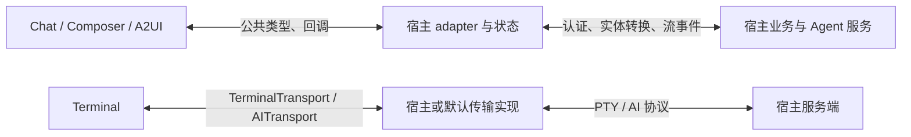
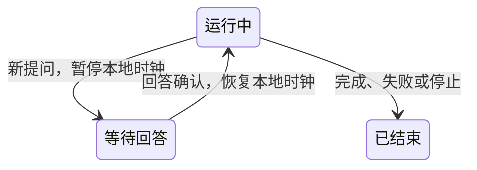

# 宿主运行契约

## 职责与数据流



## ChatAdapter

从 `@personai/agent-ui-chat-core` 导入类型。必需成员为 `capabilities`、`createSession`、`deleteSession`、`loadMessages`、`loadAguiEvents`、`streamMessage`；具体参数与返回值以目标版本类型声明为准，尤其 `deleteSession` 返回 `ChatSession` 而非 void。

| 可选能力 | 对应实现与约束 |
| --- | --- |
| 结构化历史 | `loadHistory` 返回权威 `SessionHistory`；常规读取不再靠重放协议拼装历史 |
| 运行恢复 | `supportsActiveRun` + `getActiveRun`；保留 run 身份及观察状态 |
| 协议回放 | `supportsProtocolReplay` + `loadProtocolEvents`；与普通历史读取区分 |
| 真正停止 | `supportsStop` + `stopRun`，调用后端停止运行 |
| 运行中调整 | `supportsSteer` + `steerMessage`，保留运行上下文 |
| 用户问题 | `supportsUserInputRequests` + `loadUserInputRequests` / `answerUserInputRequestStream` |
| 附件 | `uploadAttachment` / `downloadAttachment`；请求、鉴权与存储由宿主处理 |
| 交付文件 | `supportsArtifacts` + `artifactAction` / `artifactContentUrl`；宿主解析动作与 URL |
| A2UI | `loadA2uiState` / `sendA2uiActionStream`；宿主恢复状态并路由操作 |
| 删除历史轮次 | `deleteTurn(sessionId, {rootRunId, expectedVersion}, signal)`；后端保证版本检查及业务删除语义 |

只有后端具备对应能力时才启用标志/方法；不要用成功返回的空实现假装支持。`supportsAbort` 表示观察请求可中断，不能替代 `supportsStop`。`streamMessage` 的 AbortSignal 用于断开浏览器观察，宿主拥有的运行只由停止接口取消。

### 流、历史与错误

- 保留 `TEXT_MESSAGE_START`、`TEXT_MESSAGE_CONTENT`、`TEXT_MESSAGE_END` 的稳定 `messageId` 并实时转发 `handlers.onAguiEvent`；历史使用同一 ID，不能等整轮结束后再拆成卡片。
- 老适配器可调用 `onDelta`。同一内容同时发送两种回调时先 AG-UI 再裸文本，避免镜像增量重复。
- 保留事件 ID、executionId、sourceSequence、工具调用 ID 与运行身份；不要只按时间戳排序后丢弃源顺序。续跑可有不同 executionId。
- `TEXT_MESSAGE_END` 只关闭一条消息，不等同于整轮成功。失败、取消、等待输入时保留已收正文，不伪造成功结果。
- 将宿主错误映射为 `ChatAdapterError`，保留 code/status/details。`rejectedBeforeAdmission` 只有后端保证输入尚未保存或执行时才能设为 true，避免队列重复发送。
- 失败运行需要可观测入口时，在终止 `RUN_ERROR` 事件上附带 `diagnostic: { traceId, href }`。`traceId` 只接受 `[A-Za-z0-9][A-Za-z0-9._:-]{0,127}`；`href` 只接受以单个 `/` 开头的同源路径，绝对 URL、`//host` 与 `javascript:` 会被丢弃。可选 `parseChatRunDiagnostic` 在适配层归一化；`HistoryRun.error` 是字符串，不包含 trace 信息。
- 问答与恢复请求的 question/option ID 要双向映射，包含 `resume[].payload.answers` 的嵌套字段；metadata 不替代后端权限检查。

源码导航：`packages/chat-core/src/{types,history,a2ui,artifacts}.ts`、两端 ChatRuntimeWindow、`docs/integration-guide.md`、`docs/chat-a2ui.md`。

## 独立 Composer

使用 `composer-react` / `composer-vue` 导出的 `Composer`。`draft` 由宿主控制；React 使用 `onDraftChange`，Vue 使用 `draft-change`。发送回调区分 `send`、`queue`、`steer`；运行中可用模式通过 `runningSubmitModes` 配置，不能把界面显示的 steer 当成后端能力。

宿主实现上传、发送、停止、队列存储与排序等回调。输入法确认不应发送，Shift+Enter 换行；`/` 查询命令/技能，`$` 仅查询技能。选中后标签显示草稿中的 `$name`，`displayName` 和描述不替代技能标识。粘贴会读取剪贴板中的图片和其他文件，按剪贴板顺序对每个文件调用 `onPasteAttachment`；同一剪贴板还含纯文本时保留文本插入。React/Vue 的参数细节以各自 Props 与事件声明为准。

源码导航：`packages/composer-core/src/types.ts`、两端 Composer、`docs/composer.md`、各包 README。

## 独立 A2UI 与聊天集成

```ts
import { A2UIClient, CATALOG_ID } from '@personai/agent-ui-a2ui-core';
const client = new A2UIClient();
client.apply({ version: 'v0.9.1', createSurface: {
  surfaceId: 'profile', catalogId: CATALOG_ID, sendDataModel: true,
}});
```

这里的 `v0.9.1` 是 schema 要求的协议版本，不能改成 `1.0.0-preview.3`。展示完整内容还需后续组件与数据消息。以同版本 core 导出的 Catalog/schema 为准，不宣称支持整个官方 Basic Catalog。

- 宿主解析 JSONL/SSE 字节流后，每次把一个完整消息交给 `apply`；捕获校验错误，不直接传入网络 chunk。
- 完整消息形如 `{"version":"v0.9.1","updateComponents":{"surfaceId":"profile","components":[...]}}`；不要平铺操作字段。当前源码的 `TextField.placeholder` 支持字符串/路径绑定，不影响标签和提交值；此能力从 `1.0.0-preview.4` 开始提供，需前后端使用匹配的 Catalog。
- React/Vue 使用 `A2UISurface`，提供 client 和 surfaceId，并处理 `onAction(message, metadata)`（Vue 属性 `on-action`）。宿主路由业务、Agent 和审批；组件不自行请求服务。
- `sendDataModel` 的内容位于 `metadata.a2uiClientDataModel.surfaces`。订阅返回的取消函数要释放；快照恢复使用 `exportSnapshot` / `importSnapshot`。
- 自定义组件要同时注册 Catalog schema 与渲染器；仅加渲染函数不会绕过校验。QuestionCard / ApprovalCard 收集用户选择，审批授权仍在后端。
- Chat 集成通过 adapter 的 A2UI 状态与 action 方法承接，避免重新实现第二套聊天渲染链。
- `ChatA2uiSession.messages()` 生成的 `channel: "a2ui"` 消息只负责展示 Surface，通常没有 `history`。运行状态由同一 `runId` 的权威历史与当前执行事件决定；不能因这些展示消息缺少历史记录而重开已完成的运行，也不能仅凭 Surface 存在判定完成。该修复目前仅在源码中。

源码导航：`packages/a2ui-core/src/index.ts` 及 schemas、两端 A2UI 导出、`docs/a2ui-client.md`、`docs/chat-a2ui.md`。

## 交付文件（Artifacts）

完成的助手消息可用 `ChatMessage.artifacts` 携带扁平文件列表。宿主负责合并、去重和按客户端计算 `actions`；UI 不接收文件路径或 `source` 对象：

```ts
interface ChatArtifacts {
  version: "v1";
  items: ChatArtifactItem[];
}
```

- `actions` 是权威列表，只接受 `preview`、`open`、`reveal`、`save`；`actions[0]` 为主按钮，`actions[1]` 以内联次按钮显示，`actions[2..]` 进入溢出菜单。缺省或空数组表示只展示、不显示按钮。
- `parseArtifacts` 对未知 `version`、非数组 `items` 和缺少 `id` / `display` 的条目返回 `null` 或丢弃条目，从不抛错；空 `items` 不渲染。协议版本 `v1` 与 npm 包版本无关。
- 超过 `ARTIFACT_COLLAPSED_COUNT`（4）项时折叠。`states` 按条目 id 标记 `pending` / `failed`，失败时 UI 重试上次动作（缺省为主按钮）。
- React/Vue adapter 实现 `artifactAction(session, { runId, itemId, action }, signal)` 执行 `open` / `reveal` / `save`，以及 `artifactContentUrl(session, { runId, itemId, disposition })` 返回 `inline` / `attachment` URL；仅在后端支持时声明 `supportsArtifacts`。运行时预览用 `inline` URL 打开新标签页，`onArtifactPreview` 可替换。
- React/Vue 组件 props 一致：`artifacts`、`onAction`、`onPreview`、`labels`、`locale`、`states`。RN 使用 `ArtifactList`，动作是内联按钮行；没有宿主 `onPreview` 时不显示预览，也不自行打开 URL。

源码导航：`packages/chat-core/src/{artifacts,types}.ts`、`packages/chat-react/src/ChatArtifacts.tsx`、`packages/chat-vue/src/components/ChatArtifacts.vue`、`packages/chat-react-native/src/ArtifactList.tsx`、`docs/integration-guide.md`、`docs/react-native.md`。

## Motion 与主题

用 `MotionProvider` 传入宿主保存的偏好；基础示例 `config={{ mode: 'system', duration: 180, distance: 8 }}`。Chat/A2UI 两端都重导出 Provider；独立效果使用 `AgentMotion`。

`off` / `reduced` 显示静态内容，祖先关闭不可由子 Provider 重开。仅明确的 `replayKey` / preset 变化重播，不能用 key 重建输入表单；自定义 effects 必须尊重 enabled 和局部清理。更多参数与主题变量见 `docs/motion.md`。修改公共主题时使用主题 skill；消费方只覆盖公开变量与挂点。

## Terminal

在 DOM 挂载后初始化，容器需有可用尺寸：

```ts
import { initTerminal, createTerminalTransport } from '@personai/agent-ui-terminal';
import '@personai/agent-ui-terminal/styles.css';

const terminal = initTerminal({
  el: terminalElement,
  transport: {
    terminal: createTerminalTransport({ url: terminalEndpoint }),
  },
  locale: 'zh-CN',
  onError: reportError,
});
// 在宿主卸载/关闭回调中执行：
// terminal.dispose();
```

示例中的元素、地址、错误处理由宿主提供。默认 PTY transport 是 Socket.IO，不是任意 WebSocket 协议；默认 AI transport 为 SSE。协议不兼容时实现 `TerminalTransport` / `AITransport`，AI 可选，缺省不影响普通终端。

初始化主题通过 `terminalOptions.themeTokens`，运行中用 `setThemeTokens` / `resetTheme` / `refreshTheme`；语言通过 `locale` / `messages` 和返回实例的方法更新。关闭时调用 `dispose()` 释放 xterm 和传输；宿主传输实现也需落实请求取消和资源清理，服务端负责 PTY 回收。

源码导航：`packages/terminal/src/index.ts`、`src/transport/{types,protocol}.ts`、`src/terminal/types/themes.ts`、终端 README。


从 `1.0.0-preview.3` 开始，`initTerminal()` 返回实例还提供 `clear(): void`、`getSelection(): string`、`focus(): void`；旧的 `1.0.0-preview.2` 没有这三个方法。升级后直接调用返回实例，不导入未导出的内部 Terminal 类，也不用类型强转伪造接口。

`clear()` 委托 xterm 清空缓冲区并保留当前提示行，不向 shell 发送命令，不停止 PTY 或删除宿主历史；`getSelection()` 未选中文本时返回空字符串；`focus()` 聚焦现有输入。三者保留主题和语言，销毁后不再调用。为宿主提供清屏/复制/聚焦按钮时，分别使用这些接口，并验证焦点、选择文本和终端连接仍正常。

### 终端运行期工具详情（`1.0.0-preview.31`）

终端活动区的思考、工具组和单个工具都使用原生 `<details>`。运行期间即可展开和收起；流式事件到达只更新标题和内容，不会把用户已展开的详情重新折叠，运行结束也不重置展开状态。展开后可查看工具参数和已经返回的结果，结果稍后到达时继续写入同一项。宿主升级到该版本后不再需要用 CSS 或事件拦截限制运行期点击。

接入验收应在真实后端覆盖：工具仍在运行时可展开；工具已结束但整轮未结束时仍可展开；新事件到达后已展开项保持打开；“终止会话”仍能停止当前运行；结束后主题切换、终端输入和 `dispose()` 无回归。源码导航：`packages/terminal/src/terminal/ui/agentActivity.ts`、`packages/terminal/src/terminal/styles/model-session.scss`、终端 README。

### Compaction block details (since 1.0.0-preview.5)

`ChatCompactionBlock` contains `id`, `beforeTokens`, `afterTokens` and `kind`
(`compressed` or `summary`). A reduction must lower its token count; generated
summaries are reported separately. Do not infer reductions from budgets or list
unchanged blocks as compressed.

Live hosts send `CUSTOM agent.memory.compaction.details` with `{ blocks }` after
assembly, associated with the same run as the compaction lifecycle. Completion
may also carry `{ blocks }`. Detail events do not finish a run or create a notice
without a compaction lifecycle. For durable history, provide
`HistoryStep.compaction = { blocks }` on the corresponding compaction step.
Match the run and step interval; never attach the session's latest snapshot to
older steps. Omitted details mean unavailable; `[]` means no confirmed changes.

React and Vue use a keyboard-accessible native disclosure for finished notices.
Use `labels.notices.compactionBlock(block)` to translate block names/results;
`compactionNoChanges` and `compactionDetailsUnavailable` translate empty states.

```text
assembler facts → live detail + lifecycle → disclosure
saved step + matching report → history step.compaction → same disclosure
```

## 图片历史展示

ChatPanel 将实时图片附件和历史 `Media` 图片显示为缩略图，点击打开原图预览；宿主不必重写消息或丢弃批注元数据。缩略图大小只影响展示，不改变发送给模型的图片。消费方应安装包含此修复的 npm 版本；源码修改不代表已经发布。尺寸变量见主题 skill 的 Chat 主题契约。

用户历史图片与实时附件归入对应用户消息组，缩略图位于消息正文上方并沿右边缘对齐；多张图片自动换行，点击仍打开原图预览。助手和系统消息不使用用户消息的右对齐分组。

批注弹层挂到 body 时复制来源聊天的主题颜色；保存按钮使用 `--agent-ui-chat-primary` / `--agent-ui-chat-on-primary`（回退到宿主 `--color-primary` / `--color-on-primary`），悬停混合主题色，禁用态不触发悬停变化。

## 工作状态与前端计时（1.0.0-preview.7）

React/Vue 工作栏按稳定的轮次 ID 持有 `WorkElapsedClock`，首次装载时从历史计算初值，运行期间通过 `performance.now()` 累加、每秒刷新。事件到达不会重置初值或驱动时间跳变；等待输入、完成、失败、停止时暂停，回答确认后继续累计。卸载时释放定时器，重新装载时从历史恢复。`WorkElapsedClock(initialElapsedMs)`、`setRunning(running, now?)` 和 `elapsed(now?)` 也由 chat-core 导出。

`Answered` / `Skipped` 请求的 `answeredAt` 和交互回答消息可消除较早的暂停标记，但不能消除之后的新提问。宿主保留问题身份、运行别名及时间；提交失败且未得到后端确认时仍可显示原待答问题。一次中断终止不代表后续回答恢复已经完成。



## 对话历史定位栏（`1.0.0-preview.12`）

React `ChatRuntimeWindow` / `ChatPanel` / `ChatWindow` 与 Vue `ChatRuntimeWindow` / `ChatPanel` 默认显示左侧历史定位栏；宿主可用 React `showHistoryRail={false}`、Vue `:show-history-rail="false"` 关闭。Vue `ChatWindow` 的类型虽包含 `showHistoryRail`，当前源码未把它传给内部 `ChatPanel`，需要关闭时先核对目标版本或改用 `ChatPanel`。它只影响展示，不改变后端历史读取或 `loadHistory` 契约。

索引绝对定位在聊天左侧既有留白内，不占用正文和输入框宽度；普通轮次为微点，当前轮次为短竖线。悬停或键盘聚焦显示问题与最多两行纯文本回复摘要；点击、Enter 或空格只滚动正文，方向键、Home/End 选择轮次，Escape 关闭预览。长历史索引在自身范围内滚动，跳转遵循 MotionProvider 与系统减少动效设置。

主题通过 `data-theme-part="chat-history"` 和 `--agent-ui-chat-history-*` 调整；变量清单与默认值见主题 skill 的 Chat 主题契约。接入时按宿主既有留白核对 16px 点击区域，不通过增加正文 padding 容纳索引。

源码导航：`packages/chat-core/src/history-rail.css`、两端 `src/chatHistory.ts`、`packages/chat-react/src/ChatHistoryRail.tsx`、`packages/chat-vue/src/components/ChatHistoryRail.vue`、两端 Chat README。

## 工具分组总数

当前源码中，React/Vue 工具分组标题只显示已开始的工具调用总数，使用 `workRailLabels.tool.group(count)`，例如“13 个工具调用”；失败的调用也计入总数，一次批量调用计为一次。分组不再按命令、搜索、读写或其他操作分类统计，旧 `groupSummary` 回调保留类型兼容但不再调用。展开后的工具明细保持原有展示。消费方需安装包含此变更的 npm 版本后生效。
