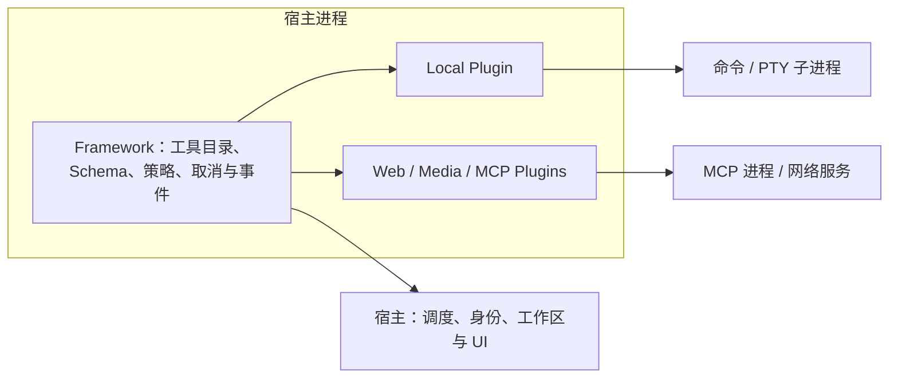

# 主流 Agent 工具对照与补齐清单

核查日期：2026-09-27。本文对照 Codex CLI、Claude Code、Nous Research Hermes Agent、Gemini CLI 和 Qwen Code 的官方文档及实际注册代码。Qwen Code 对应仓库 `QwenLM/qwen-code`。
下文区分上游工具清单、Framework 当前实现和明确的上层应用职责；实现依据见[实现状态与验收证据](实现状态与验收证据.md)。

## 结论

Framework 工具覆盖文件读写、搜索、命令后台执行、用户问答、子 Agent／Threads、Skills、可选记忆和 MCP 工具调用。
当前 Framework 已提供交互式命令、多文件编辑、代码搜索、Web/媒体、MCP 资源和工具发现等能力；业务任务清单由上层应用负责，LSP 暂未支持。
工具名称相近不代表语义一致；尤其不能把单文件字符串替换当作多文件补丁，把模型多模态输入当作本地图片读取工具。

先完善 `tools-local`，再增加按职责划分的可选工具插件。文件、命令、网络和语言服务仍由宿主显式配置权限与依赖。
官方 Rust 工具插件在宿主进程内运行；它们管理的命令、语言服务或 MCP 服务可以是独立进程。
来源、编译与启用方式见 [Crates 组织](../crates/README.md#进程边界)。

## 核查口径与来源

“提供”表示有官方工具定义或实现，**不表示所有模型、平台和会话默认启用**。
权限规则、配置开关、模型能力和插件依赖都会影响工具是否进入模型上下文。
命令行 Slash Commands、SDK 方法、模型服务端工具和 Agent 可调用工具分别看待。

| 项目 | 核查依据 | 版本边界 |
| --- | --- | --- |
| Codex CLI | [工具注册](https://github.com/openai/codex/blob/6e1ab4d294cdf1d2606a91bf1acf6de0f0959c7a/codex-rs/core/src/tools/spec_plan.rs)、[命令工具定义](https://github.com/openai/codex/blob/6e1ab4d294cdf1d2606a91bf1acf6de0f0959c7a/codex-rs/core/src/tools/handlers/shell_spec.rs) | 读取的源码快照 `6e1ab4d294cdf1d2606a91bf1acf6de0f0959c7a`；工具暴露受配置、模型、环境和 feature 控制 |
| Claude Code | [官方 Tools reference](https://code.claude.com/docs/en/tools-reference) | 当日文档快照；文档说明各项的版本、平台及配置条件；未从闭源实现推断额外能力 |
| Hermes Agent | [官方 Tools reference](https://hermes-agent.nousresearch.com/docs/reference/tools-reference)、[Tools 概览](https://hermes-agent.nousresearch.com/docs/user-guide/features/tools) | 当日文档快照；优先使用 reference 的实际工具名；概览中的 `process`／`todo` 等名称可能是旧名或分类名 |
| Gemini CLI | [官方工具参考](https://geminicli.com/docs/reference/tools/)、[实际注册](https://github.com/google-gemini/gemini-cli/blob/2fe7c2d3f065dc40ad573d50b2091116f8a4aa18/packages/core/src/config/config.ts)、[名称定义](https://github.com/google-gemini/gemini-cli/blob/2fe7c2d3f065dc40ad573d50b2091116f8a4aa18/packages/core/src/tools/definitions/base-declarations.ts) | 源码快照 `2fe7c2d3f065dc40ad573d50b2091116f8a4aa18`；文档与注册有差异时分别标注 |
| Qwen Code | [官方工具概览](https://qwenlm.github.io/qwen-code-docs/en/developers/tools/introduction/)、[文件工具](https://qwenlm.github.io/qwen-code-docs/en/developers/tools/file-system/)、[名称定义](https://github.com/QwenLM/qwen-code/blob/c662f78bcf2ac6b84565c841b3f845ee68826847/packages/core/src/tools/tool-names.ts)、[实际注册](https://github.com/QwenLM/qwen-code/blob/c662f78bcf2ac6b84565c841b3f845ee68826847/packages/core/src/config/config.ts) | 源码快照 `c662f78bcf2ac6b84565c841b3f845ee68826847`；名称常量不等于默认注册清单 |

## 各项目提供的工具

### Codex CLI

| 能力 | 工具或实现 |
| --- | --- |
| 命令与交互式进程 | `exec_command`、`write_stdin`；命令超出等待窗口返回会话 ID，支持后续输入和续读；TTY 由 feature 控制 |
| 编辑与图片 | `apply_patch`、`view_image` |
| 计划与问答 | `update_plan`、`request_user_input`；异步问答／消息工具按模型和配置开放 |
| 子 Agent | V1：`spawn_agent`、`send_input`、`wait_agent`、`resume_agent`、`close_agent`；V2：`spawn_agent`、`send_message`、`followup_task`、`interrupt_agent`、`list_agents`、可选 `wait_agent` |
| MCP | `list_mcp_resources`、`list_mcp_resource_templates`、`read_mcp_resource`；远端工具及 `tool_search` |
| 可选辅助能力 | Code Mode 执行／等待、`request_permissions`、插件安装建议、上下文预算／切换、`clock.curr_time`、`clock.sleep` |
| Web | 按配置接入服务端 Web Search，或独立的 `web.run` 扩展；需要供应商及扩展支持 |

Codex 的文件读取、目录和文本搜索主要可经命令工具完成，不能据此要求 Framework 删除已有专用文件工具。
子 Agent 两套协议也不应拼成一个“默认工具集”。注册条件见
[spec_plan.rs](https://github.com/openai/codex/blob/6e1ab4d294cdf1d2606a91bf1acf6de0f0959c7a/codex-rs/core/src/tools/spec_plan.rs)，
命令续读见 [write_stdin](https://github.com/openai/codex/blob/6e1ab4d294cdf1d2606a91bf1acf6de0f0959c7a/codex-rs/core/src/tools/handlers/unified_exec/write_stdin.rs)。

### Claude Code

| 能力 | 官方工具名 |
| --- | --- |
| 文件与代码 | `Read`、`Write`、`Edit`、`Glob`、`Grep`、`NotebookEdit`、`LSP` |
| 命令与后台任务 | `Bash`、`PowerShell`、`TaskStop`、`Monitor`；`TaskOutput` 已弃用，改用 `Read` 读取任务输出文件 |
| 问答与计划 | `AskUserQuestion`、`EnterPlanMode`、`ExitPlanMode` |
| 任务清单 | `TaskCreate`、`TaskGet`、`TaskList`、`TaskUpdate`；旧 `TodoWrite` 默认关闭 |
| 协作与工作区 | `Agent`、`ListAgents`、`SendMessage`、`SubagentHandback`、`EnterWorktree`、`ExitWorktree` |
| Skills、MCP 与 Web | `Skill`、`ToolSearch`、`ListMcpResourcesTool`、`ReadMcpResourceTool`、`WaitForMcpServers`、`WebFetch`、`WebSearch` |
| 调度与产品集成 | `CronCreate`、`CronList`、`CronDelete`、`ScheduleWakeup`、`RemoteTrigger`、`Workflow`；`Artifact`、`PushNotification`、`SendUserFile`、`ReportFindings`、`SendFeedback`、`ShareOnboardingGuide`、`EndConversation` |

当前文档说明：`Glob`／`Grep` 在 macOS、Linux、WSL 上默认不暴露，满足特定配置时恢复；
Task 工具受模型和启用配置影响，LSP 需要语言服务，跨会话消息和产品集成也有各自条件。
这些限制及完整清单见 [官方工具参考](https://code.claude.com/docs/en/tools-reference)。
`Monitor` 的输出事件推送与任务查询不同；`EnterWorktree` 同时涉及工作区和写权限，不能只添加一个工具 Schema。

### Hermes Agent

| 能力 | 官方工具名 |
| --- | --- |
| 文件 | `read_file`、`write_file`、`patch`、`search_files` |
| 命令 | `terminal`、`process_manage`；后台进程具有列表、查询、分页日志、等待、停止、写入操作 |
| 问答、清单与协作 | `clarify`、`todo_list`、`delegate_task` |
| 记忆与 Skills | `memory`、`session_search`、`skills_list`、`skill_view`、`skill_manage` |
| Web 与浏览器 | `web_search`、`web_extract`；`browser_navigate`、`browser_snapshot`、`browser_click`、`browser_type`、`browser_press`、`browser_scroll`、`browser_back`、`browser_close`、`browser_get_images`、`browser_vision` |
| 可选执行与调度 | `execute_code`、`cronjob_manage`、`computer_use`；浏览器 CDP、凭据库及程序化浏览器工具依赖配置 |
| 可选媒体和应用 | 图片／视频生成与分析、语音、Discord、Spotify、飞书、Home Assistant、Kanban、桌面 UI 等工具集 |

这里最值得借鉴的是进程管理、分页、会话检索和编辑冲突控制。已有文件的整文件覆盖要求当前版本的完整读取基线，
避免覆盖并发修改；`session_search` 检索历史消息，不能用长期记忆工具代替。
`cronjob_manage` 的任务在新会话运行，不继承当前聊天上下文。
工具名、行为及依赖见 [官方工具参考](https://hermes-agent.nousresearch.com/docs/reference/tools-reference)。
应用工具集不纳入 Framework 默认通用工具清单。

### Gemini CLI

| 能力 | 工具名 |
| --- | --- |
| 文件 | `read_file`、`list_directory`、`glob`、`grep_search`、`replace`、`write_file` |
| 命令与后台查询 | `run_shell_command`、`list_background_processes`、`read_background_output` |
| 问答、计划与进度 | `ask_user`、`write_todos`、`enter_plan_mode`、`exit_plan_mode`、`update_topic` |
| 可选任务图 | `tracker_create_task`、`tracker_update_task`、`tracker_get_task`、`tracker_list_tasks`、`tracker_add_dependency`、`tracker_visualize`，由实验开关控制 |
| Skills、MCP 与 Web | `activate_skill`、`list_mcp_resources`、`read_mcp_resource`、`google_web_search`、`web_fetch` |
| Agent 与内部工具 | 注册代码中的 `invoke_agent`；子 Agent 专用 `complete_task`；文档还列出 `read_many_files`、`get_internal_docs` |

`read_file` 文档支持文本、图片、音频和 PDF；搜索提供 ignore、排除模式、纯文本匹配及输出限制参数。
见 [官方工具参考](https://geminicli.com/docs/reference/tools/)。
核查时的 `createToolRegistry()` 没有注册 `read_many_files`／`get_internal_docs`，因此只标为文档列出，
不把它们当作已确认的默认独立工具。后台工具名称由
[shellBackgroundTools.ts](https://github.com/google-gemini/gemini-cli/blob/2fe7c2d3f065dc40ad573d50b2091116f8a4aa18/packages/core/src/tools/shellBackgroundTools.ts)
核实；实际启用仍受 [注册配置](https://github.com/google-gemini/gemini-cli/blob/2fe7c2d3f065dc40ad573d50b2091116f8a4aa18/packages/core/src/config/config.ts) 控制。

### Qwen Code

| 能力 | 工具名 |
| --- | --- |
| 文件与代码 | `read_file`、`write_file`、`edit`、`glob`、`grep_search`、`notebook_edit`、`zoom_image`；`list_directory` 默认不启用，`lsp` 需要配置和可用 client |
| 命令与监测 | `run_shell_command`、`monitor`、`task_stop` |
| 问答与计划 | `ask_user_question`、`todo_write`、`enter_plan_mode`、`exit_plan_mode` |
| Agent 与可选团队 | `agent`、`list_agents`、`send_message`；`team_create`、`team_delete`、`team_plan_approval`、`request_shutdown`、`task_create`、`task_update`、`task_list` 受团队开关及角色控制 |
| Skills、MCP 与 Web | `skill`、`tool_search`、`tool_call`、`read_mcp_resource`、`web_fetch`；`web_search` 受搜索后端、凭据与运行模式控制 |
| 可选宿主能力 | `enter_worktree`、`exit_worktree`、`cron_create`、`cron_list`、`cron_delete`、`loop_wakeup`、daemon 的 `create_sub_session`；`exec`、`structured_output`、Goal、Workflow、Artifact、图片和 Omni 媒体工具按模式配置 |

`save_memory` 在名称常量中，但核查时的常规 `createToolRegistry()` 未见对应注册；不据常量认定默认可调用。
Omni 工具也可能仅供固定编排器调用，对模型隐藏。
实际清单以 [config.ts](https://github.com/QwenLM/qwen-code/blob/c662f78bcf2ac6b84565c841b3f845ee68826847/packages/core/src/config/config.ts)
为准，名称及可选定义见 [tool-names.ts](https://github.com/QwenLM/qwen-code/blob/c662f78bcf2ac6b84565c841b3f845ee68826847/packages/core/src/tools/tool-names.ts)。
文件多模态和 Notebook 行为见 [官方文件工具文档](https://qwenlm.github.io/qwen-code-docs/en/developers/tools/file-system/)。

## Framework 已有工具

`plugin/tool/` 下有 28 个固定工具名；加上 Skills 的 3 个和 MemoryTools 的 4 个可选工具，共 35 个固定名称。
MCP 工具按服务器动态发现，资源工具按服务器声明生成，不计入固定数量。**这不是默认全部开启的工具数量。**

| 实现位置 | 已有工具 | 启用和边界 |
| --- | --- | --- |
| [tools-local](../crates/plugin/tool/eliteforge-agent-official-plugin-tools-local/src/tools.rs) | `fs_read_text`、`fs_list`、`fs_stat`、`search_grep`、`search_glob`、`search_path`、`fs_write_text`、`fs_apply_patch`、`command_exec`、`command_exec_read`、`command_exec_stop`、`command_exec_write`、`command_exec_list` | 读取、写入、命令分别显式启用；文件工具限制在配置的根目录，命令不由该根目录自动隔离 |
| [tools-human](../crates/plugin/tool/eliteforge-agent-official-plugin-tools-human/src/lib.rs) | `ask_user` | 1–3 个问题、每题 2–5 个选项，允许文本回答／跳过；返回 `AwaitInput`，宿主提交答案后恢复；没有多选或无选项提问 |
| [tools-agents](../crates/plugin/tool/eliteforge-agent-official-plugin-tools-agents/src/lib.rs) | `agent_spawn`、`thread_create`、`thread_send`、`thread_answer`、`thread_wait`、`thread_read`、`thread_list`、`thread_close` | 子 Agent 继承运行约束；默认 Thread registry 在进程内，不提供跨宿主团队或 Git worktree 隔离 |
| [tools-mcp](../crates/plugin/tool/eliteforge-agent-official-plugin-tools-mcp/src/lib.rs) | 服务器发现的工具 | stdio／HTTP transport、工具分页、命名空间、取消及关闭；已接入资源列表、模板与读取；未提供 prompts API |
| [tools-discovery](../crates/plugin/tool/eliteforge-agent-official-plugin-tools-discovery/src/lib.rs) | `tool_search` | 显式包装授权 Provider，按 run 公开 Schema；保留原调用链与租约生命周期 |
| [tools-web](../crates/plugin/tool/eliteforge-agent-official-plugin-tools-web/src/lib.rs) | `web_search`、`web_read` | 后端和域名策略由宿主配置；来源 URL、大小限制、取消和超时；不执行浏览器脚本 |
| [tools-media](../crates/plugin/tool/eliteforge-agent-official-plugin-tools-media/src/lib.rs) | `media_read_image`、`media_read_pdf` | 目录约束、图片媒体块和 PDF 分页文本；不含 OCR、渲染或 Notebook |
| [plugin/skill](../crates/plugin/skill/eliteforge-agent-official-plugin-skills/src/tools.rs) | `skill_load`、`skill_read_resource`、`skill_diagnostics` | 已有聚合清单与按需读取；未提供技能创建、修改和删除工具 |
| [plugin/memory](../crates/plugin/memory/eliteforge-agent-memory/src/components.rs) | `memory_search`、`memory_get`、`memory_save`、`memory_delete` | 需宿主注册 MemoryTools；默认只读，写入需 `allow_writes()`；命名空间由宿主绑定；不等于历史会话搜索 |

官方能力包默认有 Human、Agents、Skills 和空 MCP 来源；本地文件／命令以及 MemoryTools 需另行选择。
SQLite 默认保存记忆，不表示模型默认拥有记忆写入工具。
默认装配见 [crates/README.md](../crates/README.md#官方能力如何启用)。

## 当前实现与扩展范围

| 能力 | 当前状态 | 实现或边界 | 状态分类 |
| --- | --- | --- | --- |
| 超过 10 秒返回任务 ID、后续读取和停止 | 已支持 | `command_exec` 等待超过 10 秒后返回命令 ID；`command_exec_read` 读取状态与输出，`command_exec_stop` 停止命令。命令记录在 Agent 内按会话隔离 | 已支持 |
| 交互式命令与进程管理 | 已支持 | 支持持续 stdin、PTY、命令清单和受管进程组清理；平台验收范围见[实现状态与验收证据](实现状态与验收证据.md) | 已支持 |
| 多文件补丁与编辑冲突 | 已支持 | 支持多文件增删改/移动、版本前置条件、diff 预览和失败回滚；跨文件提交及外部并发修改边界见[本地文件工具](本地文件工具.md) | 已支持 |
| 代码搜索与稳定分页 | 已支持 | 支持 glob、ignore/exclude、文本/正则和多种查询模式；扫描有界，分页使用会话快照并支持取消 | 已支持 |
| MCP 资源 | 已支持 | 支持资源列表、模板、读取及模型工具调用；HTTP/stdio 传输、限额和取消测试见[实现状态与验收证据](实现状态与验收证据.md) | 已支持 |
| 工具按需发现 | 已支持 | `tools-discovery` 汇总应用明确授权的 Provider，按需公开 Schema；Provider 租约和 MCP 网络发现仍在装配时建立 | 已支持 |
| Web 搜索与抓取 | 已支持 | 支持可替换搜索后端、Brave 适配、域名策略和文本/HTML 抓取；请求有大小、超时和取消限制 | 已支持 |
| 图片与文档读取 | 已支持 | `tools-media` 返回图片媒体块和指定 PDF 页文本；不提供 OCR、PDF 渲染或浏览器脚本执行 | 已支持 |
| 用户问答形式 | 可扩展 | 复用 `tools-human`；当前支持带选项问题、文本回答和跳过，不支持多选及无选项问题 | 可扩展 |
| 历史会话检索 | 可扩展 | 长期记忆检索和 Skills 管理已有独立能力；跨历史会话的全文检索需由应用或专用插件提供 | 可扩展 |
| Notebook | 可扩展 | 可增加 Notebook 读取和单元格编辑能力，复用媒体读取和本地文件授权 | 可扩展 |
| 浏览器与桌面控制 | 可扩展 | 可由应用或 MCP 插件接入；宿主需提供浏览器会话、凭据和操作审批 | 可扩展 |
| 多个 Agent 团队协作 | 可扩展 | 可组合子 Agent、独立 Thread 和 DAG；团队分工及跨进程协作策略需显式实现 | 可扩展 |
| 程序化工具组合 | 可扩展 | 可选增加 Code Mode，用于批量调用现有工具和筛选结果；普通脚本执行不等于工具编排接口 | 可扩展 |
| 业务任务清单与进度 | 上层应用负责 | 命令清单只管理实际运行的命令，不表示用户待办或业务工作流状态 | 上层应用负责 |
| LSP 语言服务 | 上层应用负责 | Framework 当前不提供 LSP 工具；由应用或专用语言服务插件接入 | 上层应用负责 |
| 后台调度与长期监控 | 上层应用负责 | 当前进程内命令可查询和停止；跨重启调度、唤醒和事件订阅由应用负责 | 上层应用负责 |
| 定时任务与 Worktree | 上层应用负责 | 调度器、跨进程队列、Git 工作区隔离和生命周期策略由应用部署管理 | 上层应用负责 |
| 命令与工具沙箱 | 上层应用负责 | Framework 提供目录授权、取消、超时和策略扩展点；操作系统隔离环境由应用配置 | 上层应用负责 |
| 终端、命令行与 HTTP 产品接口 | 上层应用负责 | Framework 提供 Agent 运行时和事件协议；交互界面、HTTP 路由和命令分发由应用实现 | 上层应用负责 |
| 文件历史、Diff 与 Rewind | 上层应用负责 | 文件工具可执行有版本校验的编辑；Git 历史、变更界面和撤销流程由应用提供 | 上层应用负责 |
| 项目与个人设置 | 上层应用负责 | 应用负责读取、合并、授权和保护设置，再把生效配置交给 Framework | 上层应用负责 |


命令工具的当前保证及限制见 [tasks.rs](../crates/plugin/tool/eliteforge-agent-official-plugin-tools-local/src/tasks.rs)。
文件编辑和搜索边界见[文件工具](本地文件工具.md)，新增插件配置见[可选工具插件](可选工具插件.md)。
MCP 边界由 [McpClient 与插件注册](../crates/plugin/tool/eliteforge-agent-official-plugin-tools-mcp/src/lib.rs) 确认。

## 建议的插件组织

Local、MCP、Discovery、Web 和 Media 已有实现；Browser 是后续可选项。默认装配仍为 8 个进程内插件。

```text
crates/plugin/
├── tool/
│   ├── eliteforge-agent-official-plugin-tools-local       文件、搜索、补丁、命令与进程
│   ├── eliteforge-agent-official-plugin-tools-human       问答与交互
│   ├── eliteforge-agent-official-plugin-tools-agents      子 Agent 与 Threads
│   ├── eliteforge-agent-official-plugin-tools-mcp         MCP 工具与资源适配
│   ├── eliteforge-agent-official-plugin-tools-discovery   通用工具目录与 Schema 按需公开
│   ├── eliteforge-agent-official-plugin-tools-web         搜索与抓取
│   ├── eliteforge-agent-official-plugin-tools-media       图片与 PDF 文本；Notebook 暂缓
│   └── eliteforge-agent-official-plugin-tools-browser     可选后续：浏览器
├── skill/                                                Skills 的加载与管理
├── memory/                                               记忆与历史会话检索
├── model/                                                模型调用与媒体生成 Provider
└── protocol/                                             AG-UI 等事件协议
```

工具按需发现属于 Framework 的通用工具生命周期，不能只在 MCP 插件内部实现。
任务清单由上层应用维护；Plan Mode 的切换还要调整宿主策略、工具权限和执行阶段，不能由 Todo 状态代替。
媒体生成复用已有模型能力，按需提供工具适配；不把每个供应商复制成 `tool/` 插件。
Git 的普通查询／提交可由命令工具和 Skills 组合，暂不新增只有 Shell 包装的 `tools-git`。



## 第一批开发的验收条件

1. **交互式命令**：继续满足默认 10 秒返回 taskId；增加同会话命令清单和 stdin 写入；PTY 可选；
   停止、超时和 Agent 关闭回收直接进程及其受管子进程；输出有界，续读游标明确标识截断。
2. **文件编辑**：保留现有 `fs_apply_patch` Schema；新增多文件补丁入口，支持文件创建、修改、删除和移动；
   修改前核对文件版本，返回修改摘要／diff；冲突或非法路径时不遗留部分修改，并明确跨文件提交的边界。
3. **搜索与读取**：支持完整 glob、可配置 ignore／exclude、纯文本或正则、文件名／内容／计数模式；
   分页返回可继续的位置和截断原因，扫描有取消、时间和容量限制；文件变化时说明分页是否失效。

第二批补 MCP 资源与工具发现、Web、图片／PDF。网络与文档工具要有超时、容量限制和来源信息；
按需发现后的工具仍经过相同的 Schema 校验、权限与取消链。

上游核查未实测五个 CLI 的运行表现。Framework 实现与测试证据单独记录，不将上游能力视为 Framework 已有能力。
